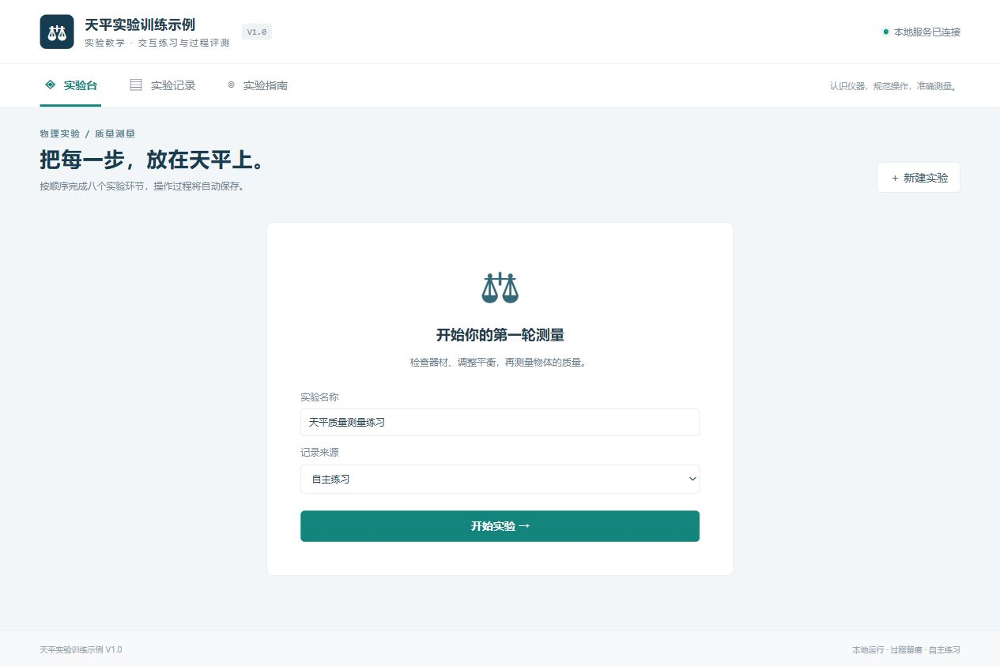

# 软著材料准备 Skill

[](#安装)
[](#安装)
[](https://github.com/handsomeZR-netizen/software-copyright-materials/releases/latest)

给 AI 编程助手（Claude Code、Codex）用的技能包：根据项目的真实源码，制作中国计算机软件著作权登记需要的使用说明书、源程序鉴别材料和网页申请填写内容，并把代码整理成 `code.zip`。

[示例说明书 PDF](examples/balance-lab/材料/使用说明书.pdf) · [示例源程序 PDF](examples/balance-lab/材料/源程序鉴别材料.pdf) · [下载发布版本](https://github.com/handsomeZR-netizen/software-copyright-materials/releases/latest)

## 产出内容

| 产出 | 说明 |
| --- | --- |
| 使用说明书 PDF | 用 TeX 模板排版，TeX 原稿和配图留在制作底稿里，方便以后修改 |
| 源程序鉴别材料 PDF | 从原始文件抽取，附文件顺序、原始行号和 SHA-256 映射 |
| 申请信息填写清单.md | 按网页表单字段顺序整理，脚本校验必填项、字数和源程序量 |
| `code.zip` | 源码、配置、锁文件、测试、构建产物、启停脚本和逐文件校验 |
| 合作开发协议 | 默认不做；点名需要时，用 `agreement.py` 基于仓库内的 DOCX 模板生成 DOCX |

## 遵循的原则

- 说明书只写已经实现的功能，截图来自实际运行的软件。
- 源码只收原创部分，不收依赖和自动生成的代码；长行折行只按一行计数，空行不印刷。
- 超过 60 页时取前后各 30 页，不足 60 页全部提交；不靠删内容、补空行或缩小字号凑页数。
- 软件名称、版本、日期、源码行数在说明书、源程序材料和填写清单里保持一致。
- 著作权人、权属、开发完成日期、发表情况等事实以用户提供的为准，不知道的留空待补。
- 交付的 PDF、填写清单、协议和 `code.zip` 不出现 AI 编程工具名称，`code.zip` 不带 `CLAUDE.md`、`AGENTS.md`、`.claude/`、`.codex/` 等配置；`verify` 会扫描并报错。
- 只准备材料，不替用户提交申请、签署文件或联系第三方。

## 安装

在 PowerShell 中执行：

```powershell
git clone https://github.com/handsomeZR-netizen/software-copyright-materials.git
cd software-copyright-materials
```

| 安装到 | 命令 | 目标目录 |
| --- | --- | --- |
| Claude Code 个人目录 | `.\scripts\install.ps1 -Personal -Claude` | `~/.claude/skills` |
| Claude Code 某个项目 | `.\scripts\install.ps1 -ProjectRoot '项目目录' -Claude` | `项目目录/.claude/skills` |
| Codex 个人目录 | `.\scripts\install.ps1 -Personal` | `~/.codex/skills`（或 `$CODEX_HOME/skills`） |
| Codex 某个项目 | `.\scripts\install.ps1 -ProjectRoot '项目目录'` | `项目目录/.agents/skills` |

安装脚本会把完整示例一起复制到 skill 的 `assets/complete-example`。目标位置已有同名 skill 时脚本会停止，检查过现有内容后再加 `-Force` 覆盖。不用 PowerShell 的话，可以手动把 `.agents/skills/software-copyright-materials` 复制到对应的 skills 目录。

## 使用

在 Claude Code 里直接描述任务，例如“帮我给 D:\projects\xxx 准备软著材料”，或输入 `/software-copyright-materials`。

在 Codex 里：

```text
使用 $software-copyright-materials 为我的新项目准备软著源码材料、TeX说明书和网页申请填写参考，按“代码/材料”布局整理。
```

开始前准备好这些信息：

- 项目路径
- 软件全称和版本号
- 著作权人
- 开发完成日期（已知的话）
- 已有的说明书模板或历史材料（如果有）

## 运行环境

- Python 3.10 及以上，以及 PyMuPDF、Pillow：`pip install -r .agents/skills/software-copyright-materials/scripts/requirements.txt`
- XeLaTeX（TeX Live 或 MiKTeX）。不在 PATH 里时，在配置中用 `xelatex` 字段写绝对路径。
- 模板默认使用 Windows 中文字体。macOS 或 Linux 上，在配置中设置 `ctex_fontset`（如 `mac`、`fandol`）和 `cjk_mono_font`。

## 命令行流程

技能会按这个流程调用脚本，也可以手动运行。配置文件放在 `材料/制作底稿/config.json`，所有路径都相对于配置文件解析，与当前工作目录无关。

```text
写配置 → init → 编写说明书、截图 → build → 目视检查 → package
```

```powershell
$kit = '.agents/skills/software-copyright-materials/scripts'
$cfg = '材料/制作底稿/config.json'
python $kit/materials.py init    --config $cfg   # 生成说明书 TeX 骨架和填写清单（已存在时不覆盖）
python $kit/materials.py build   --config $cfg   # 编译两份 PDF 到 材料/，并自动执行 verify
python $kit/materials.py verify  --config $cfg   # 单独复核
python $kit/materials.py package --config $cfg   # 复核通过、清单无“待填”后生成 代码/code.zip
python $kit/check_web_form.py --input 材料/制作底稿/web-form.json --stats 材料/制作底稿/源码清单与统计.json
python $kit/agreement.py --config 材料/制作底稿/agreement.json --pdf   # 合作开发协议（点名需要时）
```

`verify` 会检查源码哈希和行号顺序、A4 尺寸、页眉页脚、目录页码与实际跳转目标、残留的模板文字，并把每页渲染成图片放进 `qa/`，供人工目视检查。机器检查通过不代表排版没有问题，联系页（多页缩略图拼在一张图上）和关键页面仍然需要人看一遍。

目录结构：一个软著一个文件夹，多个软著并列放。

```text
<软件全称> V1.0/
├─ 代码/                      项目源码，package 生成的 code.zip 也放这里
└─ 材料/
   ├─ 使用说明书.pdf
   ├─ 源程序鉴别材料.pdf
   ├─ 申请信息填写清单.md      对照官网申请页逐项填写
   ├─ 合作开发协议.docx        仅点名需要时生成
   └─ 制作底稿/
      ├─ config.json
      ├─ manual-tex/           说明书 TeX 原稿和配图
      ├─ source-tex/           源程序 TeX（每次 build 重新生成）
      ├─ qa/                   逐页图片和联系页
      └─ 源码清单与统计.json、复核结果.json 等记录
```

`材料/` 根部只放要上传或填写的文件，其余都在 `制作底稿/`。

### 配置

从 [config.example.json](.agents/skills/software-copyright-materials/references/config.example.json) 复制一份开始填写。必填项：

| 字段 | 说明 |
| --- | --- |
| `software_name` / `software_version` | 软件全称和版本，各份材料必须一致 |
| `copyright_owner` | 实际著作权人 |
| `project_root` | 项目根目录，相对于配置文件；按上面的布局时默认 `../../代码`，可不写 |
| `source_files` | 收入源程序材料的原创源文件，按排版顺序列出 |

常用可选项：`package_files` 列出放进 `code.zip` 的其他文件，可以写目录或通配符，如 `"dist/**"`。`development_date` 是开发完成日期。`stale_terms` 列出不应出现在 PDF 中的旧项目名称。完整说明见 [材料制作与复核](.agents/skills/software-copyright-materials/references/materials-workflow.md)。

## 完整示例

[examples/balance-lab](examples/balance-lab/README.md) 是一个匿名的“天平实验训练示例”，可以运行，配套材料是按上面的流程做出来的：

| 内容 | 数量 |
| --- | --- |
| 使用说明书 | 14 页，目录 1 页 |
| 源程序材料 | 55 页，共 2,756 个非空源码行 |
| 界面截图 | 7 张，均从实际运行中采集 |
| 应用测试 | 14 项 |



运行示例需要 Node.js 22.18 及以上：

```powershell
cd examples/balance-lab/代码
npm ci
npm test
npm run build
npm start          # 打开 http://localhost:3187
```

在仓库根目录重新生成示例材料：

```powershell
python .agents/skills/software-copyright-materials/scripts/materials.py build --config examples/balance-lab/材料/制作底稿/config.json
```

示例的软件名称、著作权人、日期和记录编号都是虚构的，不能用于真实申请。这些页数也只是这个示例的结果，不是其他项目必须达到的要求。

## 仓库结构

```text
.agents/skills/software-copyright-materials/
├─ SKILL.md                 技能入口
├─ references/              制作流程、登记要求、网页字段、交付布局、协议模板说明
├─ assets/
│  ├─ tex-template/         说明书与源程序 TeX 模板、等宽字体
│  └─ agreement-template/   合作开发协议 DOCX 模板
└─ scripts/                 materials.py、check_web_form.py、agreement.py 及测试
examples/balance-lab/       完整匿名示例（代码 + 材料）
scripts/
├─ install.ps1              安装脚本
└─ audit_release.py         发布前检查身份信息、凭据和本机路径
```

## 开发

```powershell
python -m unittest discover -s .agents/skills/software-copyright-materials/scripts -p 'test_*.py' -v
```

修改脚本后要跑这 21 项测试；修改示例应用逻辑后要跑示例的 npm 测试并重新构建。贡献约定见 [AGENTS.md](AGENTS.md)。

## 使用边界

- 本技能只提供材料制作和技术检查，不代替身份与权属确认，也不代替登记机构的审查，不保证获证。
- 登记规则和网页字段会变。仓库记录的字数限制来自 2026 年 10 月的表单截图，正式申请时要以当时的官方要求和页面为准。
- 交付材料只描述软件本身，不写开发过程用了什么工具；平台要求声明开发方式时，由本人按实际情况填写，技能不代为声明。
- 公开仓库中的示例已经匿名处理，不包含真实姓名、项目标识、申请日期、本机路径、签名、证件或凭据，Git 提交也使用匿名作者。
- 本仓库公开展示源码和材料，但不额外授予商业使用、再许可或转让的权利。第三方组件和字体遵守各自附带的许可。
